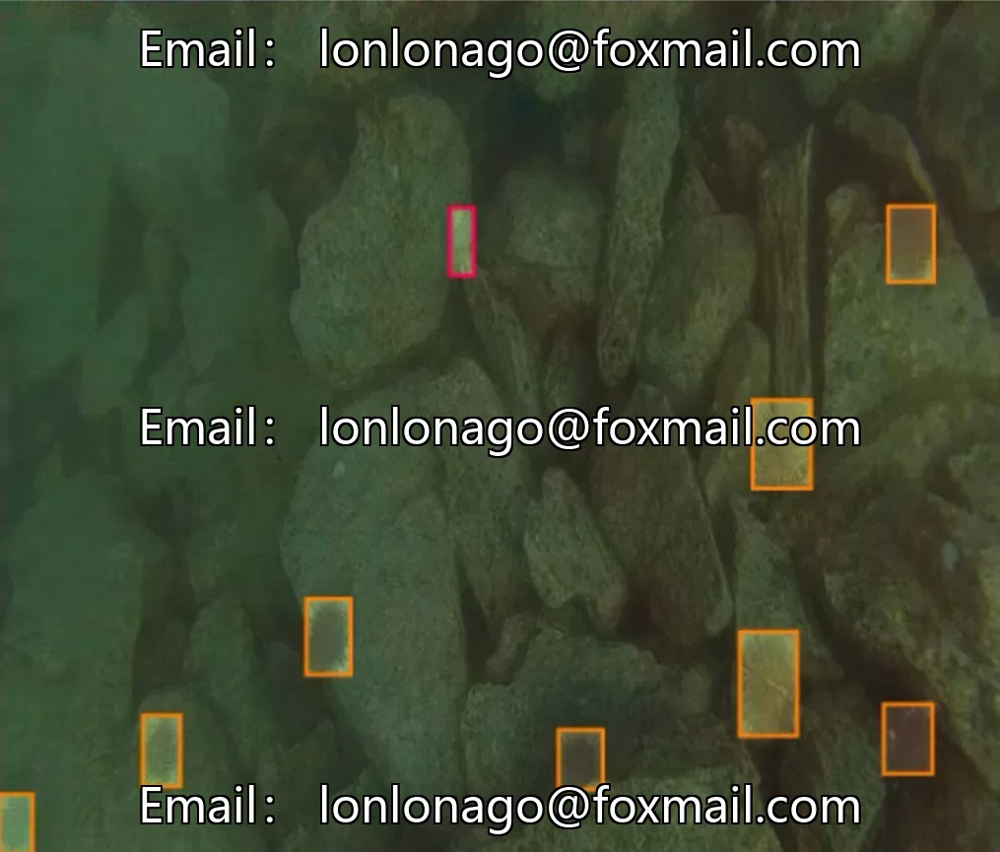
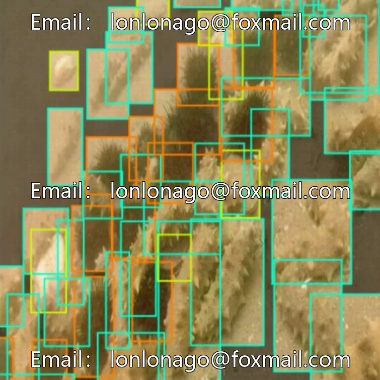
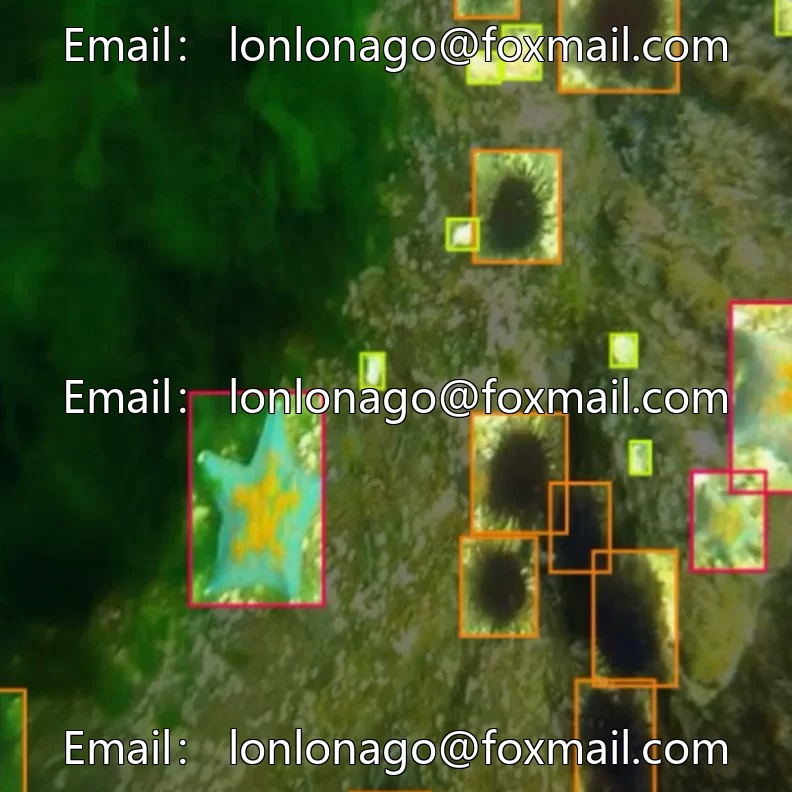
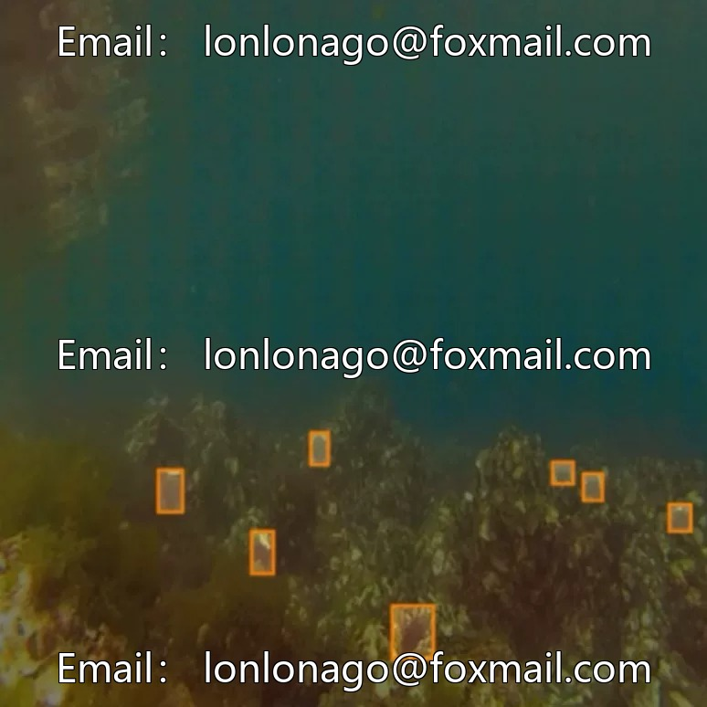

# Intelligent Detection - Underwater Object Detection Dataset, including sea urchins, sea cucumbers, scallops, starfish, water.

## Body

Underwater Object Detection Dataset for Intelligence, comprising five types of underwater organisms including sea urchins, sea cucumbers, scallops, starfish, and water plants, totaling 7251 images. It is divided into two sub-datasets, supporting training with the Yolo object detection model.

The data format is an image file, accompanied by bounding box annotations, suitable for scenarios such as marine biomonitoring and underwater environment exploration. Data coverage of common underwater species, standardized annotation, training requirements met.

Virtual materials, once sold, are non-refundable.
Interested friends, click "I want" to proceed.

## Images

## Payment

Here is a pay link on Stripe ( https://buy.stripe.com/3cs8yP7sY87d0vu9AB ). Please contact me lonlonago@foxmail.com after funding $89, and I will send you a complete data files , thank you!

